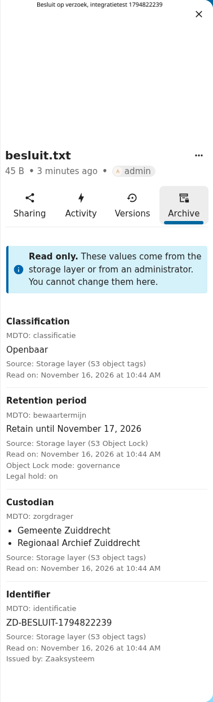

<!--
  - SPDX-FileCopyrightText: 2026 Conduction B.V.
  - SPDX-License-Identifier: AGPL-3.0-or-later
-->

# Archive metadata (archiefmeta)

See the archival metadata of a file in the Nextcloud Files sidebar. Nobody can change it there.

The values come from the storage layer. For a file on S3 that means Object Lock retention, legal hold, and object metadata or tags. Every value shows its source and the moment it was read.



This app is a proof of concept. It was built by Conduction for the Common Ground assignment "archiefwaardige opslag" (deliverable D3, backend metadata). Any government can use and change it under the AGPL.

## Documentation and project notes

The documentation site is [archiefmeta.conduction.nl](https://archiefmeta.conduction.nl). Its source is in [`docs/`](docs/): the user and admin guide, the architecture, the evidence from the test runs, and the project notes of the assignment (in Dutch): the D1 analysis, the progress notes, the state of the talks with Nextcloud and the MDTO alignment. To build it locally: `cd docs && npm ci --legacy-peer-deps && npm run build`.

## What it does

- Adds a read-only **Archive** tab (Dutch: **Archief**) to the Files sidebar.
- Shows four fields named after their MDTO element: `classificatie`, `bewaartermijn`, `zorgdrager` (one or more) and `identificatie`.
- Shows for every value its source ("bron") and when it was read.
- Reads the values again when a file is written, copied or moved, and on `occ archiefmeta:refresh`.
- Refuses every edit. WebDAV PROPPATCH on `nc:metadata-archiefmeta-*` fails for every user, owners included. The app has no write endpoint.

MDTO is the Dutch metadata standard for durable government information ("Metagegevens voor duurzaam toegankelijke overheidsinformatie").

## Why an app and not a core change

Nextcloud is adding a metadata schema API in Nextcloud 36 ([nextcloud/server#66355](https://github.com/nextcloud/server/pull/66355)). That API has no user interface on purpose. It expects an integration app for each use case. This is that app for archival metadata.

Until that API ships, the app stores values with the existing core API `OCP\FilesMetadata\IFilesMetadataManager` (Nextcloud 28 and later). See [Architecture](https://archiefmeta.conduction.nl/architecture/) ([source](docs/architecture.md)) for how the switch works.

## Requirements

- Nextcloud 34, 35 or 36
- PHP 8.2 or later
- For storage layer values: primary object storage on S3, or a files_external "Amazon S3" mount. Without S3 the app still works with values an administrator sets.

## Install

```bash
git clone https://github.com/ConductionNL/archiefmeta.git
cd archiefmeta
npm ci && npm run build
cp -r appinfo lib l10n js img LICENSE /path/to/nextcloud/custom_apps/archiefmeta/
sudo -u www-data php occ app:enable archiefmeta
```

For a Docker container there is a helper: `scripts/install-into-container.sh <container>`.

Enabling the app registers the four metadata keys as not editable. Files written before you enabled the app have no values yet. Read them with:

```bash
occ archiefmeta:refresh --recursive alice/files
```

When you redeploy a changed build under the same app version, browsers may keep the old script. Raise the version in `appinfo/info.xml` or clear the browser cache.

## Where values come from

The app asks its sources in a fixed order. Per field, the first source with a value wins.

| Order | Source | Label in the tab | Fields |
|---|---|---|---|
| 1 | S3 Object Lock | Storage layer (S3 Object Lock) | bewaartermijn |
| 1 | S3 object metadata | Storage layer (S3 object metadata) | all four |
| 1 | S3 object tags | Storage layer (S3 object tags) | all four |
| 2 | Administrator, through `occ archiefmeta:set` | Administrator | all four |
| 3 | Nextcloud file ID | Nextcloud file ID (not durable) | identificatie |

### S3 keys

For `bewaartermijn` the app reads the Object Lock retention of the object (`GetObjectRetention`: mode and retain-until date) and its legal hold (`GetObjectLegalHold`). A legal hold without a retention date shows as "No end date (legal hold)". When the object has no lock, the app falls back to the metadata key below.

For the other fields the app reads user metadata first, then object tags with the same name.

| Field | User metadata header | Tag key | Example |
|---|---|---|---|
| classificatie | `x-amz-meta-mdto-classificatie` | `mdto-classificatie` | `Openbaar` |
| bewaartermijn (no lock) | `x-amz-meta-mdto-bewaartermijn` | `mdto-bewaartermijn` | `2036-01-01` |
| zorgdrager | `x-amz-meta-mdto-zorgdrager` | `mdto-zorgdrager` | `Gemeente Zuiddrecht` |
| identificatie | `x-amz-meta-mdto-identificatie` | `mdto-identificatie` | `ZD-2026-0001` |
| issuer of the identifier | `x-amz-meta-mdto-identificatie-systeem` | `mdto-identificatie-systeem` | `Zaaksysteem` |

More than one zorgdrager or classificatie? Separate them with `;` in metadata. Tag values cannot hold `;`, so use numbered keys there: `mdto-zorgdrager-1`, `mdto-zorgdrager-2`. Numbered keys work in metadata too.

Header values must be ASCII. Percent-encode other characters as UTF-8 (`Gemeente%20%C3%96`); the app decodes them.

Where to set them:

- **Primary object storage.** The object key is `urn:oid:<fileid>`. Nextcloud writes the object, so set tags afterwards, for example `mc tag set s3/bucket/urn:oid:123 "mdto-classificatie=Openbaar"`. Then run `occ archiefmeta:refresh 123`.
- **External S3 mount.** The object key is the path inside the mount. A system that writes into the bucket can set user metadata on upload. Run `occ files:scan` and `occ archiefmeta:refresh` to pick it up.

### Object Lock setup

Object Lock must be enabled when you create the bucket. Versioning comes with it. A default retention puts a lock on every new object:

```bash
mc mb --with-lock s3/archive
mc retention set --default GOVERNANCE 10y s3/archive
```

Nextcloud core does not yet send version IDs when it deletes from a versioned bucket. A delete then leaves a delete marker and the locked bytes stay. That is tracked separately ([nextcloud/server#66498](https://github.com/nextcloud/server/issues/66498)).

## Commands

```text
occ archiefmeta:refresh <path|fileid> [--recursive]   read the sources again
occ archiefmeta:show <path|fileid> [--json]           print the stored values
occ archiefmeta:set <path|fileid> [--classificatie=..]... [--zorgdrager=..]...
                    [--bewaartermijn=2036-01-01] [--identificatie=..]
                    [--clear=<field>]... [--clear-all]
```

A path is relative to the data root, such as `alice/files/Report.pdf`.

## Read only, and how it is enforced

- Each key is registered with `IMetadataValueWrapper::EDIT_FORBIDDEN`. Core's WebDAV handler then refuses PROPPATCH for every user. Nextcloud 34 answers HTTP 500 with the message "you do not have enough rights to update 'archiefmeta-…' on this node". A 403 would be the better status; that is a core matter.
- The app API has one route: `GET /ocs/v2.php/apps/archiefmeta/api/v1/files/{fileId}`. It answers 404 for a file the user cannot access. POST, PUT, PATCH and DELETE answer 405.
- Only the storage layer and `occ` change values. Both need access users do not have.

## Tests

```bash
composer install
composer check            # php -l, php-cs-fixer (Nextcloud standard), PHPStan level 8, PHPUnit
npm ci && npm run lint && npm run build
tests/Integration/live-test.sh   # against a running instance, see below
```

`tests/Integration/live-test.sh` runs against a live Nextcloud with S3 primary storage and an S3 external mount. It uploads files, sets tags and metadata with the MinIO client, refreshes, and tries to change values through PROPPATCH and the API. Requests, status codes and bodies go to `build/integration/evidence.md`. Its defaults match Conduction's test environment; override them with environment variables (see the top of the script). Credentials have no default: set `ADMIN_PASS`, `TEST_PASS`, `S3_KEY` and `S3_SECRET`.

[The demo script](https://archiefmeta.conduction.nl/guide/demo/) ([source](docs/guide/demo.md)) walks through the app for a live audience.

## Limitations

- **Identity is not durable yet.** Without an identifier from the storage layer, `identificatie` shows the Nextcloud file ID with the instance ID. The tab says so. The file ID is unique within one instance only. Durable identity is under discussion with Nextcloud ([nextcloud/server#66499](https://github.com/nextcloud/server/issues/66499)).
- **Values are a snapshot.** The app reads the storage layer on write, copy, move and `occ` refresh. A tag changed later in S3 shows after the next refresh. The read time in the tab tells you how old a value is.
- **S3 only.** Other storage layers need their own source class. A register as source fits the same interface.
- **Schema API switch planned.** The storage class moves to the Nextcloud 36 schema API once it is released. See [Architecture](https://archiefmeta.conduction.nl/architecture/).
- **No public share pages.** The tab is hidden on public share links.

## License

AGPL-3.0-or-later. See [LICENSE](LICENSE).
