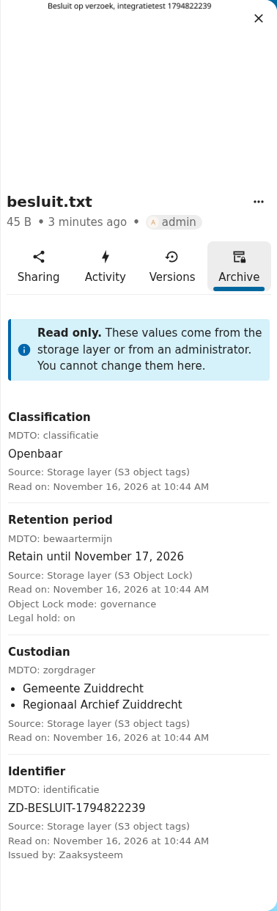

# archiefmeta

archiefmeta shows the archival metadata of a file in the Nextcloud Files sidebar. Nobody can change it there.

The values come from the storage layer. For a file on S3 that means Object Lock retention, legal hold, and object metadata or tags. Every value shows its source and the moment it was read.

## Why it exists

Dutch governments must keep records in line with the Archiefwet. A file that has to be kept may not disappear, and its archival metadata may not drift from what the storage enforces. A Nextcloud app can promise that, but another app or an administrator can get around it. A storage layer that refuses the change cannot be bypassed.

archiefmeta covers one part of that: it makes the metadata from the storage layer visible in Files, read only, with its source. It is the proof of concept for deliverable D3 of the assignment "Nextcloud archiefwaardige opslag, iteratie 1". Conduction carries out the assignment for the Common Ground programme of VNG. Open WebConcept is the Product Owner.

## What it does

- Adds a read-only **Archive** tab (Dutch: **Archief**) to the Files sidebar.
- Shows four fields named after their MDTO element: `classificatie`, `bewaartermijn`, `zorgdrager` and `identificatie`.
- Shows for every value its source and when it was read.
- Refuses every edit, through WebDAV and through its own API.

## Where to go next

- [User and admin guide](./guide/): install the app, set values on S3, and use the `occ` commands.
- [Architecture](./architecture.md): sources, the store, and the planned switch to the Nextcloud 36 schema API.
- [Project: archiefwaardige opslag](./project/): the analysis, progress notes and the state of the talks with Nextcloud, in Dutch.
- [Evidence](./category/evidence): the raw test runs behind the claims.

The app is licensed under AGPL-3.0-or-later. Any government can use and change it.
